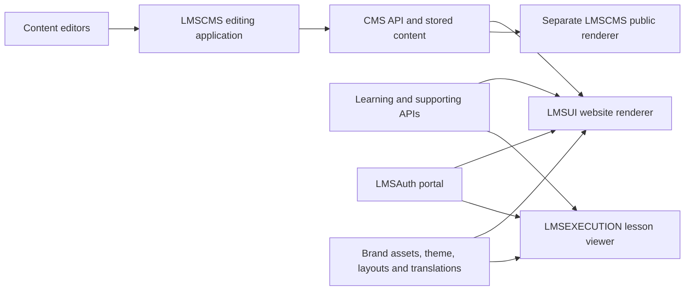

# GenericLMS — Content ownership and rendering map

Date: October 25, 2026
Status: Planning and review only. No application implementation is authorized by this document.

## 1. Purpose and constraints

Build a shared learner frontend for HP LIFE, Galilee, and RSTI while preserving existing API contracts, data models, editorial workflows, and the LMSAuth authentication portal. HP LIFE's existing appearance is a compatibility requirement, including its distinct public-site and lesson-player layouts.

This document maps content ownership and rendering dependencies. It is not a complete backend specification, production content export, or sign-off that all screens have been reviewed.

- Do not modify the original LMSUI, LMSEXECUTION, LMSCMS, LMSAuth, or LMSAdmin repositories for this planning work.
- Do not push anything to GitHub or change hosted content, permissions, or learner progress.
- Do not migrate or rewrite CMS HTML/CSS during the first rebuild phase.
- Keep brand selection separate from environment selection and user permissions.
- Do not copy the admin-only access gate from GenericLMSAdmin into the learner site.

## 2. Evidence and confidence

| Evidence | Confirmed | Limits |
|---|---|---|
| LMSCMS source | Page/site/asset models, editing requests, HTML/CSS preview, template composition, permissions represented in models, and public rendering path | CMS backend implementation and production content records were not inspected |
| LMSUI source | CMS selectors, service calls, frontend composition, brand overrides, static page regeneration configuration | Deployed version may differ from the current checkout |
| LMSEXECUTION source | Task types, learner/coach requests, progress and assessment contracts, separate learning shell | Every task type and embedded package has not been tested live |
| Public HP LIFE browser review | Homepage, navigation, catalogue, course detail, footer, public sign-in | Not a full accessibility or device audit |
| Signed-in HP LIFE browser review | Home, dashboard in-progress and certificate views, completed course detail, completed-survey viewer, outline collapse | No answers submitted, enrollment performed, or learning activities run; badges/archive contents and other task views remain unreviewed |
| Environment files | Separate API bundles, languages and feature flags exist for each brand/environment | Test configuration does not prove production configuration or feature availability |

## 3. System and ownership map

The CMS API, not this web repository, stores the published content. The two CMS-consuming renderers are separate implementations. Do not assume LMSCMS's own template renderer is what currently serves every life-global.org page.

| Concern | Current source of truth | Renderer / controller | Rebuild treatment |
|---|---|---|---|
| Editorial pages and campaign sections | CMS page records | LMSUI route/section components | Preserve existing paths, content and styling |
| Categorization of editorial content | CMS attributes and values | Frontend attribute queries | Treat exact filter names/values as integration contracts |
| Page translations and SEO | CMS records | Route/locale resolution and head metadata | Preserve translation relationships and per-language metadata |
| Navigation labels and interface copy | Frontend translation files, with brand overrides | Shared shell and component logic | Keep separate from editorial HTML |
| Logos, fonts, diagonal brand shapes | Brand assets and components, plus any CMS styling dependencies | Public-site and learning shells | Record and preserve both sources |
| Courses, categories, enrollment and completion | Learning API | Catalogue, dashboard and task viewer | Keep existing API/model semantics |
| Course descriptions, lesson bodies and task questions | Learning API; maintained through the admin tool | Course detail and task renderers | These are not CMS website pages |
| Books, badges, notifications, licenses and subscriptions | Their configured services | Feature-specific screens | Enable only for the matching configured environment |
| Authentication and session refresh | LMSAuth and identity service | Existing portal and client integrations | Preserve learner/coach/admin distinctions |
| CMS templates and site chrome | CMS template/header/footer/style/script records | LMSCMS public renderer and preview | Verify production usage before applying them to GenericLMS |

## 4. CMS read contracts used by LMSUI

Single page:

`GET {cmsApi}/page?site={siteCode}&path={cmsPath}&language={language}`

Page collection:

`GET {cmsApi}/pages?site={siteCode}&language={language}&{attributeFilter}&page={page}&resultsPerPage={size}`

The frontend configuration supplies the `site=...` selector. Current test configuration uses `hp-life`, `galilee`, and `rsti`, respectively. Confirm each production value before connection.

The single-page model consumed by LMSUI includes `title`, `heading`, `content`, `style`, `featuredImageUrl`, and SEO description/keywords. Collection records include fields used for cards and articles such as path, title, publish date, author, description and image.

These are CMS paths, not necessarily browser URLs. For example, browser `/about` requests CMS `about-page`.

### All 17 configured single-page bindings

A binding in source does not prove that a populated production record exists or that its feature is enabled for every brand.

| Website area / route | CMS path | Existing consumer / composition | Preservation requirement |
|---|---|---|---|
| Help `/help` | `help-page` | Help static props and Help page | Preserve content, headings, styling and links |
| About `/about` | `about-page` | About static props; combined with success stories | Preserve body/CSS/SEO and surrounding brand layout |
| Partners `/partners` | `partners-page` | Partners static props | Preserve logos, links and page styling |
| Terms `/termsOfUse` | `terms-of-use-page` | Static-data terms adapter | Preserve route where used; retain HP's actual legal link destinations |
| Privacy `/privacy` | `privacy-page` | Static-data privacy adapter | Confirm per-brand route versus external legal URL |
| Cookies `/cookie` | `cookie-usage-page` | Static-data cookie adapter | Confirm per-brand route versus external legal URL |
| Resources `/resources` | `resources-page` | Resources static props and page | Preserve authored links, downloads and CSS |
| Public homepage introduction | `before-login-about-us-section` | Homepage HTML section; also supplies homepage title/SEO | Preserve section HTML/CSS and metadata ownership |
| Public homepage partner section | `before-login-partners-section` | Homepage HTML plus frontend navigation action | Preserve section layout and partner links |
| News listing `/news` | `news-list-page` | CMS page banner plus attribute-selected articles | Preserve listing introduction, styling and article navigation |
| Badge information `/badges` | `badges-list-page` | CMS introduction plus rewards-service data | Keep editorial content separate from earned-badge records |
| App download `/download/app` | `download-app-banner` | Download-app content adapter, feature gated | Preserve store links and brand assets; verify active routing |
| Success stories `/successstories` | `success-stories-list-page` | CMS banner plus story collection | Preserve listing and story presentation |
| AI in Action `/ai-in-action` | `ai-videos-list-page` | CMS banner plus video collection | Preserve embedded-content behavior where enabled |
| Public homepage statistics | `before-login-marketing-statistics-section` | Homepage HTML and combined CSS | Preserve layout and editor ownership of figures |
| Start teaching `/start-teaching` | `start-teaching-page` | Feature-gated static-data adapter | Verify whether used in each deployment |
| Catalogue introduction `/allcourses` | `all-courses-page` | CMS introduction combined with learning catalogue | Preserve copy/CSS while course records continue to come from Learning API |

The source inventory contains 17 single-page bindings and five collection filters. All are listed here; runtime availability still requires verification.

### All five attribute-selected feeds

| Feed | Exact filter | Where it appears | Dependency |
|---|---|---|---|
| News articles | `featureScope=news` | News list/detail and homepage news | Individual article path, language, dates, description, image |
| Success stories | `featureScope=success-stories` | Stories list/detail, homepage and About composition | Author, description and image are required by the current homepage story filter |
| AI videos | `featureScope=ai-videos` | AI in Action list/detail | Preserve authored HTML and embedded content |
| Public-home campaign banners | `featureScope=news-banners-before-login` | Before-login carousel | List query followed by a page request for each returned path |
| Signed-in campaign banners | `featureScope=news-banners-after-login` | Signed-in homepage/news carousel | Same list/detail dependency; separate from learner course data |

The carousel adapter fetches the selected collection, requests each banner's full content in parallel, and excludes banner responses reported as errors. This behavior affects missing slides and must be made explicit in the rebuild.

## 5. Rendering and styling responsibilities

### LMSUI composition

- Homepage fetches CMS sections and editorial collections alongside Learning API categories.
- Public-home section CSS is concatenated into head styles; each campaign banner also contributes its own style block.
- Many standalone informational routes pass CMS `content`, `style` and SEO through static props to a branded frontend component.
- Editorial cards may be frontend components built from CMS summary fields, rather than complete CMS HTML pages.
- The course catalogue and course-detail shell combine CMS content, Learning API records and frontend translations.
- Dashboard enrollment, progress, certificate and badge data are not supplied by CMS.
- The generic `[slug]` route in the current LMSUI checkout is a group-home route backed by the Learning API. It is not a universal CMS-page catch-all. Preserve explicit article/section route mapping.

### LMSCMS standalone composition

- Pages have a nullable template reference.
- Templates reference header/footer IDs and stylesheet/script ID lists.
- Public-page responses contain resolved header/footer HTML/CSS plus stylesheet/script URLs.
- The CMS public renderer adds head metadata/styles, renders HTML, and loads template scripts.
- Editor preview composes HTML/CSS and selected template resources inside an iframe.

**Compatibility question:** LMSUI's consumed public-page type does not declare these resolved template fields. Confirm which HP LIFE pages use which renderer, including any embedded or externally hosted pages. Do not add a second header/footer to pages already inside the LMSUI shell.

### HTML/CSS compatibility requirements

Preserve existing class names, required CSS variables, media queries, asset paths, link destinations, fonts and embedded-content behavior during the first implementation. Do not globally strip styles/scripts or move HTML into a new block format without comparing representative records and understanding dependencies.

At the same time, define a reviewed policy for trusted editorial HTML, isolated previews, allowed embedded content and template scripts. The eventual renderer must protect the surrounding application without silently breaking existing content.

## 6. Editing, publishing and permissions

The page editor currently includes:

- Preview, HTML and CSS views.
- Path, language, title, heading, author, description, image and SEO fields.
- Parent/translation references, template selection and recursive attributes.
- An Active/Inactive page status and a publication date.
- Page-manager access represented through permission records.
- Create, update, duplication and featured-image operations.

Assets use a separate Pending/Published/Archived status model. Do not treat asset status and page status as the same state machine.

Backend questions still open: publication-date enforcement, whether edits to Active pages become immediately public, revision history, approval workflow, rollback, translation fallback, and how related pages are ordered. The reviewed page model exposes no explicit revision/approval objects, but that does not establish what the backend supports.

Do not apply invisible autosave directly to live CMS pages on the assumption that a separate unpublished revision exists. Existing admin lesson autosave is not evidence that CMS publication has the same semantics.

CMS visibility and editing access must continue to be enforced by its service. Role-cookie UI checks alone are not proof of permission to modify content. Learner-route visibility and editorial permissions are separate concerns.

## 7. Language, caching and publication freshness

Current code:

- LMSUI's standard static-page regeneration interval is 60 seconds.
- LMSCMS's standalone public renderer also specifies a 60-second revalidation interval.
- These are eligibility intervals, not a guarantee that all visitors see an edit within exactly 60 seconds. Requests, caches and regeneration failures can affect freshness.
- LMSCMS's standalone public query uses `['public', host, path]` while its request also varies by language. The missing language dimension is a source-level cache-collision risk; no live cross-language failure was demonstrated in this review.
- Draft/editor preview and public content must not share a cache entry.

Planned requirements: isolate content by environment, site/host, language, path/filter, pagination and audience where relevant; keep authenticated learner data separate from public content. Start with existing API contracts and revalidation behavior. Any future publish-triggered invalidation or webhook depends on backend support and is not assumed available.

## 8. HP LIFE visual acceptance baseline

| Screen/state | Must preserve | Review coverage |
|---|---|---|
| Public home | Compact white navigation, Forma font, HP blue, diagonal campaign image treatment, section composition, cards and dark branded footer | Live public review |
| Catalogue | Diagonal blue banner, category treatment, course cards, filters and pagination | Live public review |
| Course detail | Hero and image panel, enrollment/completed actions, overview/lessons/offline tabs | Live public and completed-course review |
| Sign-in | Existing branded portal layout and login options | Public appearance only; no automation of credentials |
| Signed-in home | Welcome area, enrolled-course carousel, progress, editorial news and latest-course presentation | Live signed-in review |
| My Dashboard | Search, In progress/Certificates/Badges/Archived controls, progress cards, transcript and certificate actions | In-progress and Certificates contents observed; badge/archive contents not inspected |
| Learning shell | Black header, title/progress, white learning area, right-hand collapsible outline, selected/completed task styling and footer | Completed-survey viewer and outline collapse observed |
| Editable form/quiz/test/assignment/video/meeting/xAPI | Task-specific layouts, validation, submission/completion rules and embedded behavior | Source reviewed; live visual coverage outstanding |
| Narrow/RTL layouts | Navigation collapse, card sizing, outline behavior, text direction, translated lengths | Some narrow-width layouts observed; full phone/tablet and RTL comparisons outstanding |

Review differences separately from parity requirements. Possible refinements observed include excessive empty card space and required-response messaging remaining visible on a completed survey. Neither is approved for silent alteration.

Use matching viewport sizes and stable fixtures for future visual comparisons. Account-specific data, changing enrollment counts, carousel timing and new CMS campaigns must not be mistaken for styling regressions. Do not capture or redistribute learner answers as generic design fixtures.

## 9. Proposed GenericLMS boundaries — not implemented

| Boundary | Planned responsibility |
|---|---|
| Environment profile | Matching service URLs, auth portal, client ID and cookie/origin settings; validated as a bundle |
| Brand profile | Fonts, logos, colors, component variants, public/learning layouts and legal/support links |
| Experience profile | Enabled features, navigation, supported languages and page-section bindings |
| CMS adapter | Existing page/list contracts, content metadata and field normalization |
| Content renderer | Existing HTML/CSS compatibility, template policy and safe embed lifecycle |
| Learning features | Existing enrollment, progress, assessment and coach contracts |
| Session layer | Existing portal integration, bounded retry/refresh and role-aware behavior |

CMS remains the editorial system. The initial rebuild does not require a replacement CMS, new database, content migration, new page schema or custom theme-management backend. Optional future content blocks or theme editors should be planned only after compatibility is proven.

## 10. Verification register before implementation

| ID | Question / check | Evidence needed | Priority |
|---|---|---|---|
| V01 | Which production CMS site and service bundle does HP LIFE use? | Authorized read-only environment/site inspection; verify `site=hp-life` rather than assuming test settings | Before connecting |
| V02 | Which configured paths and filters have content in each language? | Read-only production inventory with record IDs, paths, attributes, statuses, dates and translations | Before rendering |
| V03 | Which renderer serves each page or embedded experience? | Map actual routes to LMSUI versus CMS public renderer and templates | Before shell composition |
| V04 | What CSS/assets/scripts do representative CMS records require? | Representative current HTML/CSS/resources and visual references | Before styling changes |
| V05 | What does saving an Active page do? | Backend contract or disposable test-environment exercise; never experiment on production content | Before editor/autosave changes |
| V06 | What are publication, revision, fallback and ordering rules? | CMS API documentation/backend review or explicit test results | Before declaring feature parity |
| V07 | What happens on missing translations, unpublished pages and failed collections? | Expected status/response examples and current-site comparison | Before error/fallback implementation |
| V08 | Can preview match the actual HP LIFE shell? | Side-by-side comparison with same record, locale and viewport | Before visual acceptance |
| V09 | Are live assessment/save/progress contracts preserved? | Test-environment fixtures for every task type, role and completion state | Before learner rollout |
| V10 | Are permissions checked consistently? | Site/page/asset capability matrix plus API-enforced denial examples | Before CMS integration expansion |
| V11 | Do uploaded images/files return the expected shapes and cancel correctly? | Test response bodies and cancellation behavior; current source has upload/response-handling paths to verify | Before upload changes |

## 11. Staged approach and exit criteria

1. **Approve the map and fill V01–V04.** Every selected launch page has a known owner, source, selector, renderer and styling dependencies. Leave unknown records marked unknown.
2. **Complete the visual baseline.** Review outstanding task types, small screens and RTL states with disposable test data or completed/read-only views. Record intended behavior without altering production learning progress.
3. **Specify shared configuration and adapters.** Agree the environment, brand, experience, CMS and session boundaries; preserve current API contracts.
4. **Implement one vertical slice only after a separate build instruction.** Use existing CMS content to demonstrate a public HP LIFE page, portal sign-in, dashboard and a test learning task. Compare visual and data behavior.
5. **Expand by feature matrix.** Add remaining editorial routes and learning features; verify every supported brand/environment separately.
6. **Plan rollout separately.** No production replacement, deployment, CMS migration or GitHub operation is authorized by this planning document.

## 12. Source references

- [LMSUI CMS selectors](C:/DYD/DYDLMS/LMSUI/src/domain/api/endpoints/staticData/constants/_hardcoded.ts)
- [LMSUI public CMS requests](C:/DYD/DYDLMS/LMSUI/src/domain/api/endpoints/cms/pages.ts)
- [LMSUI consumed CMS types](C:/DYD/DYDLMS/LMSUI/src/domain/api/endpoints/cms/interfaces/pages.ts)
- [Public-home data composition](C:/DYD/DYDLMS/LMSUI/src/staticProps/home.ts)
- [Public-home HTML/CSS rendering](C:/DYD/DYDLMS/LMSUI/src/pages/index.tsx)
- [Signed-in home presentation](C:/DYD/DYDLMS/LMSUI/src/pages/home-authenticated.tsx)
- [Banner list/detail adapter](C:/DYD/DYDLMS/LMSUI/src/domain/api/endpoints/staticData/carouselBanners.ts)
- [News detail field mapping](C:/DYD/DYDLMS/LMSUI/src/staticProps/newsDetail.ts)
- [CMS page model](C:/DYD/DYDLMS/LMSCMS/src/domain/models/pages.ts)
- [CMS template model](C:/DYD/DYDLMS/LMSCMS/src/domain/models/templates.ts)
- [CMS public-page model](C:/DYD/DYDLMS/LMSCMS/src/domain/models/public.ts)
- [CMS page editing API](C:/DYD/DYDLMS/LMSCMS/src/forPages/sites/[siteId]/pages/new_or_edit/api.ts)
- [CMS editor preview](C:/DYD/DYDLMS/LMSCMS/src/forPages/sites/[siteId]/pages/new_or_edit/PagePreview.tsx)
- [CMS standalone public route and caching](C:/DYD/DYDLMS/LMSCMS/src/pages/public/[host]/[[...path]].tsx)
- [CMS standalone HTML/style/script renderer](C:/DYD/DYDLMS/LMSCMS/src/forPages/public/[host]/[[...path]]/PageRenderer.tsx)
- [LMSUI environment, brand and service configuration](C:/DYD/DYDLMS/LMSUI/src/config/env.ts)
- [LMSUI feature flags](C:/DYD/DYDLMS/LMSUI/src/config/features.ts)
- [Learning task and operation types](C:/DYD/DYDLMS/LMSUI/LMSEXECUTION/src/domain/enums.ts)

Public visual references: [HP LIFE home](https://www.life-global.org/), [catalogue](https://www.life-global.org/allcourses?page=1), [Business Email detail](https://www.life-global.org/course/414-business-email). Authenticated layouts were viewed in the user's existing session; account data and survey answers are not reproduced here.

## 13. Signed-in HP LIFE Test CMS verification

A subsequent read-only browser review confirmed HP LIFE CMS site ID 1, About page ID 13 (`about-page`), public-home Strategic Planning banner ID 851, and signed-in banner ID 852. All sampled records show English, Published enabled, and No template. The site code/host and exact attribute selections remain unverified in the live records.

See [confirmed CMS reference records](C:/DYD/DYDLMS/GenericLMS/docs/hp-life-test-cms-reference.md) for observed HTML/CSS dependencies, preview limitations, representative milestone inputs and remaining questions. These observations refine V01–V04 but do not close their production and complete-inventory requirements.
